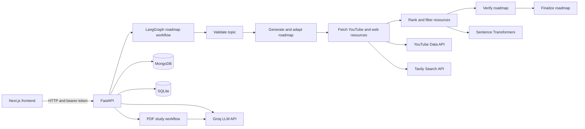

# AgentTutor

AgentTutor is an AI-assisted learning platform. It builds personalized learning roadmaps, recommends learning resources, answers questions about uploaded PDFs, and provides learner profiles and progress analytics.

## Features

- Learning assessments and personalized roadmaps
- YouTube video and web article recommendations for roadmap steps
- Learner profiles and saved recommendations
- PDF study sessions with streamed, document-grounded answers
- Authentication and learning analytics

## Architecture

The application has a Next.js frontend, a FastAPI backend, and external AI, search, and storage services.



### Main components

- **Frontend:** Next.js App Router, React, TypeScript, and Tailwind CSS. Pages cover the learning flow, assessment, roadmaps, authentication, profiles, recommendations, and PDF study.
- **Backend API:** FastAPI with Pydantic request validation. The entry point is `backend/main.py`.
- **Roadmap workflow:** LangGraph nodes validate the topic, generate and adapt the roadmap, retrieve resources, rank them, verify quality, and finalize the result. The graph is defined in `backend/xagent/graph.py`.
- **PDF workflow:** `pypdf` extracts PDF text. LangGraph manages the chat flow, and Groq streams answers grounded in the extracted text.
- **AI and retrieval:** Groq provides language-model responses; YouTube Data API and Tavily provide learning resources. The ranking agent uses Sentence Transformers with PyTorch embeddings.
- **Persistence:** MongoDB stores account, profile, and recommendation data. SQLite stores learning-session and analytics data.

## Technology stack

| Area | Technologies |
| --- | --- |
| Frontend | Next.js, React, TypeScript, Tailwind CSS |
| Backend | Python, FastAPI, Pydantic, Uvicorn |
| Agent workflows | LangGraph |
| Language model | Groq API |
| Resource search | YouTube Data API, Tavily Search API |
| Resource ranking | Sentence Transformers, Hugging Face, PyTorch |
| Data | MongoDB, SQLite |
| PDF processing | pypdf |

## Prerequisites

- Python 3.10 or newer
- Node.js and npm
- A Groq API key
- MongoDB connection string for accounts, profiles, and saved recommendations
- YouTube Data API and Tavily API keys for resource search

## Installation

Clone the repository and install the backend and frontend dependencies separately.

### 1. Configure the backend

```bash
cd backend
python -m venv .venv
```

Activate the virtual environment:

```bash
# macOS / Linux
source .venv/bin/activate

# Windows PowerShell
.venv\Scripts\Activate.ps1
```

Install Python dependencies and create your local environment file:

```bash
python -m pip install --upgrade pip
pip install -r requirements.txt
```

Copy `backend/.env.example` to `backend/.env` and set the values for your services. For example:

```dotenv
GROQ_API_KEY=your_groq_api_key
GROQ_MODEL=llama-3.3-70b-versatile
MONGO_URI=mongodb+srv://<username>:<password>@<cluster-url>/agenttutor?retryWrites=true&w=majority
MONGO_DB_NAME=agenttutor
JWT_SECRET=<a-random-secret-at-least-32-characters-long>
JWT_ACCESS_TOKEN_EXPIRE_MINUTES=60
YOUTUBE_API_KEY=your_youtube_api_key
TAVILY_API_KEY=your_tavily_api_key
```

Keep `.env` private; never commit API keys, database credentials, or JWT secrets. The YouTube and Tavily keys are needed for external resource search. MongoDB is needed for account/profile features.

### 2. Configure the frontend

In a second terminal:

```bash
cd frontend
npm ci
```

The frontend defaults to `http://127.0.0.1:8000` for the API. To use a different backend URL, create `frontend/.env.local`:

```dotenv
NEXT_PUBLIC_API_URL=http://127.0.0.1:8000
```

## Run locally

Start the backend from the `backend` directory:

```bash
uvicorn main:app --reload
```

Start the frontend from the `frontend` directory:

```bash
npm run dev
```

Open [http://localhost:3000](http://localhost:3000). The backend health endpoint is [http://127.0.0.1:8000/](http://127.0.0.1:8000/), and interactive API documentation is available at [http://127.0.0.1:8000/docs](http://127.0.0.1:8000/docs).

## Project layout

```text
backend/
  agents/           Roadmap, safety, content, and ranking agents
  services/         LLM client and persistence helpers
  xagent/           LangGraph workflows and shared state
  main.py           FastAPI application and core session endpoints
  requirements.txt  Python dependencies
frontend/
  app/              Next.js pages and layouts
  components/       Shared UI components
  lib/              API and browser session helpers
```

## Development

- Frontend lint: run `npm run lint` from `frontend/`.
- Backend syntax check: run `python -m compileall .` from `backend/`.
- Keep credentials in local environment files and avoid including generated databases, virtual environments, or build output in commits.
- For changes, open a pull request with a short description and the checks you ran.

## Security notes

The frontend currently stores bearer tokens in browser `localStorage`. Use HTTPS in deployed environments and protect the application against cross-site scripting. Never expose secrets through `NEXT_PUBLIC_*` variables; those values are bundled for the browser.

## License

This repository does not currently include a `LICENSE` file. Add a license before presenting the project as reusable open-source software or accepting contributions under specific terms.
